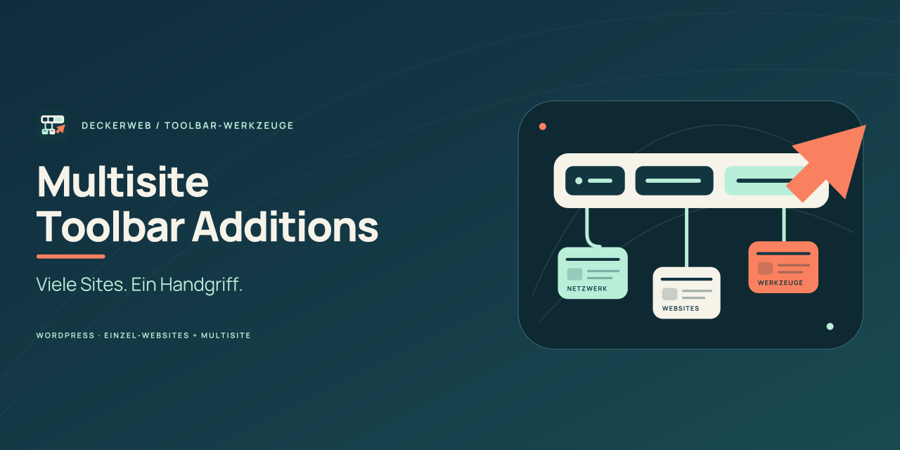
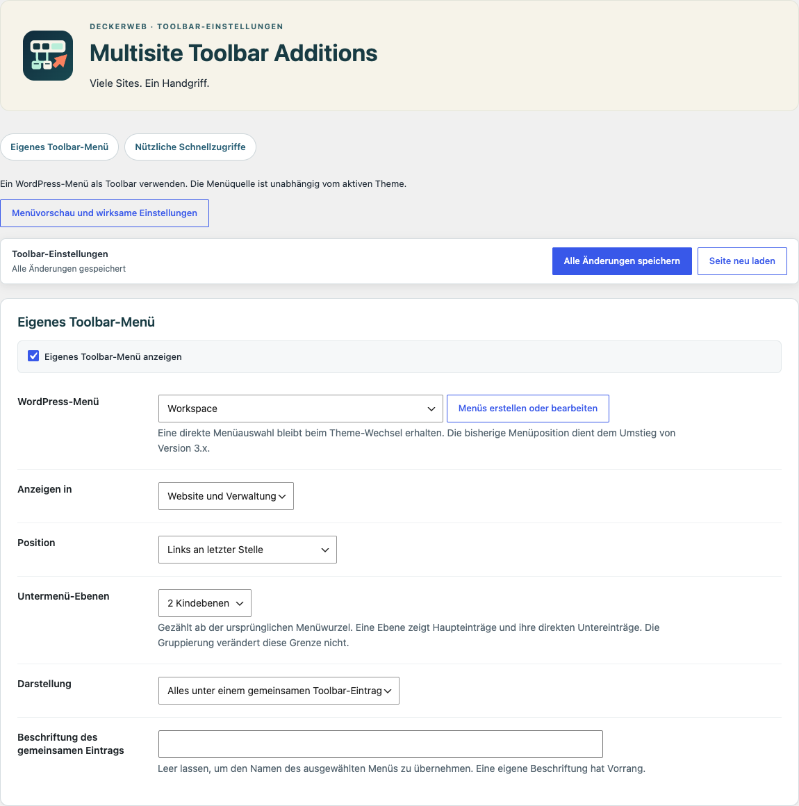
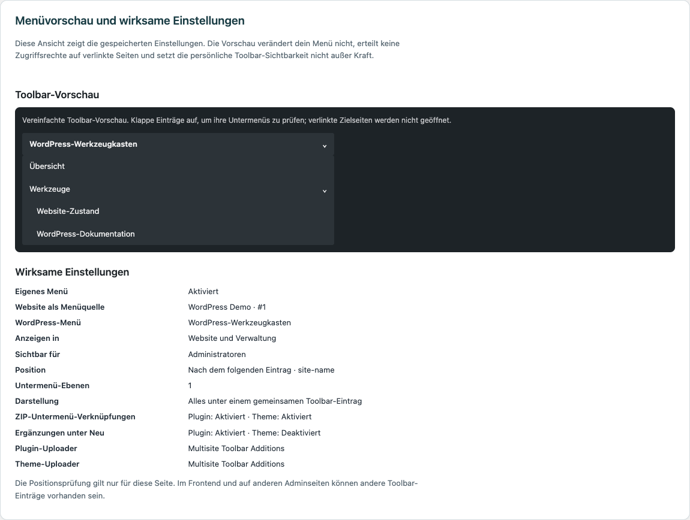

# Multisite Toolbar Additions

## Kurzvorstellung

**Viele Sites. Ein Handgriff.**

**Für einzelne WordPress-Websites und Multisite-Netzwerke. Beide werden seit 2012 unterstützt.**

Dein WordPress-Menü in der Toolbar – ergänzt um praktische Schnellzugriffe für die Verwaltung. Teil der QuickNav-Serie.

Multisite Toolbar Additions habe ich 2012 für meinen eigenen Bedarf entwickelt. Seitdem gehört es zu jeder meiner privaten und Kundeninstallationen und ist bis heute eines meiner liebsten Helferplugins für den WordPress-Alltag.

**Version 4.1.0 · WordPress 6.7+ · PHP 8.2+**

[English](README.md) · [Deutsch](README-de.md) · [Download](https://github.com/deckerweb/multisite-toolbar-additions/releases/latest) · [Fragen nach Themen](https://github.com/deckerweb/multisite-toolbar-additions/wiki/FAQ-Deutsch)

## Inhalt

[Auf einen Blick](#auf-einen-blick) · [Installation und erste Schritte](#installation-und-erste-schritte) · [Hauptfunktionen](#hauptfunktionen) · [FAQ](#faq) · [Screenshots](#screenshots) · [Changelog](#changelog) · [Über das Projekt](#über-das-projekt) · [Hilfe und Sicherheit](#hilfe-und-sicherheit) · [Lizenz und Herkunft](#lizenz-und-herkunft)

## Auf einen Blick

- Wähle Quellwebsite und Menü unabhängig vom Theme. Zeige Haupteinträge einzeln oder gruppiere sie unter dem Menünamen. Eine eigene Beschriftung ist optional.
- Wähle zuerst/zuletzt, vor/nach einem Bezugseintrag oder die rechte Seite. Zeige das Menü im Frontend, im Admin oder in beiden. Wähle eine bis zehn Kindebenen oder alle. Fehlt der Bezugseintrag, erscheint das Menü am Ende.
- Plugins und Themes stehen im Website-Toolbar-Menü direkt nacheinander, auch in Multisite. Ergänzungen unter Neu stehen am Ende und besitzen unabhängige Schalter: Plugins an, Themes aus. Beide ZIP-Admin-Untermenüs sind standardmäßig an. Upload-Links verwenden die aktiven Leitstand-Seiten oder eigene Seiten mit Drag-and-drop und begrenzter Metadatenvorschau; WordPress übernimmt die Installation.
- Nutze eine netzwerkweite Menüquelle mit optionaler Sichtbarkeit für Website-Administratoren. Gemeinsame Menüs dürfen nur Super-Administratoren bearbeiten. Zielseiten-Rechte gelten weiterhin; zusätzliche Website-Verknüpfungen sind begrenzt.
- Library 0.6.0 bietet kuratierte Plugins mit Voraussetzungs-/Prüfsummenprüfung und optionalen Online-Katalogupdates. Updater 2.1.0 nutzt normale WordPress-Updates. Assets sind lokal; es gibt keine Telemetrie.
- Prüfe die Menüstruktur mit ausgewählter Tiefe und Gruppierung ohne Speichern. Eine kompakte Übersicht erklärt Sichtbarkeit, Positionierung und verwendete Uploader. Fehlende Quellen und auf der aktuellen Seite fehlende Toolbar-Bezugseinträge werden erläutert.

## Installation und erste Schritte

Benötigt WordPress 6.7+ und PHP 8.2+. Installiere die veröffentlichte ZIP über Plugins → Installieren → Plugin hochladen. Öffne Einstellungen → Toolbar-Erweiterungen. Bei Netzwerkaktivierung verwende Netzwerkverwaltung → Einstellungen → Toolbar-Erweiterungen. Einzelaktivierung verwendet die Einstellungsseite der aktiven Website; Netzwerkeinstellungen benötigen weiterhin einen Super-Administrator. Der optionale Katalog-Installer benötigt PHP ZipArchive. Prüfe eigene 3.x-Snippets vor einem großen Upgrade.

## Hauptfunktionen

### Dein WordPress-Menü

Wähle Quellwebsite und Menü unabhängig vom Theme. Zeige Haupteinträge einzeln oder gruppiere sie unter dem Menünamen. Eine eigene Beschriftung ist optional.

### Position, Sichtbarkeit und Tiefe

Wähle zuerst/zuletzt, vor/nach einem Bezugseintrag oder die rechte Seite. Zeige das Menü im Frontend, im Admin oder in beiden. Wähle eine bis zehn Kindebenen oder alle. Fehlt der Bezugseintrag, erscheint das Menü am Ende.

### Upload-Verknüpfungen

Plugins und Themes stehen im Website-Toolbar-Menü direkt nacheinander, auch in Multisite. Ergänzungen unter Neu stehen am Ende und besitzen unabhängige Schalter: Plugins an, Themes aus. Beide ZIP-Admin-Untermenüs sind standardmäßig an. Upload-Links verwenden die aktiven Leitstand-Seiten oder eigene Seiten mit Drag-and-drop und begrenzter Metadatenvorschau; WordPress übernimmt die Installation.

### Multisite-Verwaltung

Nutze eine netzwerkweite Menüquelle mit optionaler Sichtbarkeit für Website-Administratoren. Gemeinsame Menüs dürfen nur Super-Administratoren bearbeiten. Zielseiten-Rechte gelten weiterhin; zusätzliche Website-Verknüpfungen sind begrenzt.

### Gemeinsame Komponenten

Library 0.6.0 bietet kuratierte Plugins mit Voraussetzungs-/Prüfsummenprüfung und optionalen Online-Katalogupdates. Updater 2.1.0 nutzt normale WordPress-Updates. Assets sind lokal; es gibt keine Telemetrie.

### Menüvorschau und Hinweise

Prüfe die Menüstruktur mit ausgewählter Tiefe und Gruppierung ohne Speichern. Eine kompakte Übersicht erklärt Sichtbarkeit, Positionierung und verwendete Uploader. Fehlende Quellen und auf der aktuellen Seite fehlende Toolbar-Bezugseinträge werden erläutert.

## FAQ

### Ist Multisite erforderlich?

Nein. Einzelne WordPress-Websites und Multisite-Netzwerke werden beide seit der ersten Veröffentlichung 2012 unterstützt. Auch auf einer einzelnen Website sind das konfigurierbare Toolbar-Menü, Plugin-/Theme-ZIP-Uploader, Menüvorschau und Einstellungen nutzbar. In Multisite kommen Netzwerkverwaltung und gemeinsame Menüs hinzu.

### Wie wähle ich das Toolbar-Menü?

Erstelle ein normales Navigationsmenü und wähle Quellwebsite und Menü in den Einstellungen. Netzwerkaktivierung verwendet standardmäßig die Haupt-Website; Einzelaktivierung die aktive Website. Aktiviere das Plugin auf der Quellwebsite oder netzwerkweit, damit der Schutz des gemeinsamen Menüs greifen kann. Die alte Menüposition mstba_menu bleibt als Rückfalllösung erhalten.

### Kann ich Position und Sichtbarkeit ändern?

Ja: zuerst, zuletzt, vor oder nach einem Toolbar-Eintrag oder rechts. Wähle Frontend, Admin oder beide und die zugelassenen Benutzer. Fehlt der Bezugseintrag, erscheint das Menü am Ende.

### Dürfen Website-Administratoren das gemeinsame Menü bearbeiten?

Die Sichtbarkeit des Menüs und die Berechtigung zur Bearbeitung der Quelle sind getrennt. Gemeinsame Multisite-Quellmenüs werden vor unberechtigten Änderungen im Admin, per REST und im Customizer geschützt.

### Welche Upload-Verknüpfungen sind standardmäßig aktiv?

Plugin-ZIP- und Theme-ZIP-Admin-Untermenüs sind aktiv. Der frühere ausgeschaltete Theme-Untermenü-Standard wird einmalig ersetzt; beim nächsten Speichern wird dieser Übergang vermerkt, danach bleibt ein ausdrücklich ausgeschalteter Schalter erhalten. Unter + Neu bleibt Plugin aktiv und Theme deaktiviert. Jeder Eintrag besitzt einen eigenen Schalter. Themes steht im Website-Toolbar-Menü direkt unter Plugins, auch in Multisite.

### Wie funktionieren Plugin-Updates?

Der mitgelieferte deckerweb Updater 2.1.0 prüft dieses festgelegte öffentliche Repository und speichert Release-Metadaten zwischen. WordPress steuert einzelne, gemeinsame und automatische Updates. Das Plugin aktiviert keine automatischen Updates. Pakete müssen vor dem Austausch Angebotsversion, Plugin-Identität und Plattformanforderungen erfüllen.

### Was passiert bei Deaktivierung oder Deinstallation?

Deaktivierung erhält alle Einstellungen und WordPress-Menüs. Deinstallation leert den Updatecache dieses Plugins. Toolbar-Einstellungen bleiben erhalten, sofern die Löschoption für die jeweilige Website oder das Netzwerk nicht aktiviert wurde. Bei physischer Entfernung wird die eigene Entscheidung jedes Netzwerks berücksichtigt. Die gemeinsame Library wird erst beim letzten installierten Host bereinigt, auch deaktivierte Hosts zählen; ihre Löschoption ist unabhängig. Installierte Plugins, Navigationsmenüs und fremde Inhalte bleiben erhalten.

[Fragen nach Themen](https://github.com/deckerweb/multisite-toolbar-additions/wiki/FAQ-Deutsch)

## Screenshots

Einstellungen auf einer einzelnen WordPress-Website: Toolbar-Menü, Sichtbarkeit, Position und Tiefe.

Toolbar-Menüvorschau und wirksame Einstellungen auf einer einzelnen WordPress-Website.

## Changelog

### 4.1.0 · 2026-10-07

- **Neu:** Eigene Plugin- und Theme-ZIP-Seiten bieten Drag-and-drop, Paketvorschau und ausdrückliche Installationsbestätigung. Aktive Leitstand-Uploader werden ohne doppelte Seiten verwendet.
- **Neu:** Menüstruktur, Gruppierung und Kindebenen lassen sich ohne Speichern prüfen; die Übersicht zeigt wirksame Einstellungen, verwendete Uploader und Hinweise zu fehlenden Menüquellen oder Toolbar-Bezugseinträgen.
- **Verbessert:** Eine beim Scrollen erreichbare Speichern-Leiste warnt vor dem Verlust ungespeicherter Änderungen. Das Feld für die gemeinsame Menübeschriftung ist größer.
- **Verbessert:** Beide ZIP-Admin-Untermenüs sind standardmäßig aktiv; der bisher ausgeschaltete Theme-Untermenü-Standard wird einmalig ersetzt. Spätere ausdrückliche Schalterentscheidungen bleiben erhalten. Der separate Theme-Eintrag unter Neu bleibt standardmäßig aus.
- **Verbessert:** Plugins und Themes stehen im Website-Toolbar-Menü direkt nacheinander, auch in Multisite. Einzelaktivierung wird mit durch Super-Administratoren verwalteten Netzwerkeinstellungen unterstützt.
- **Verbessert:** Gemeinsame Komponenten auf Library 0.6.0 und Updater 2.1.0 aktualisiert, mit deutschen Du-/Sie-Übersetzungen und lesbarem lokalem Änderungsverlauf.
- **Behoben:** Vertauschte Plugin-/Theme-ZIPs werden mit einem Hinweis zum passenden Uploader erkannt. Neue Theme-Pakete können vor ihrer ersten Installation korrekt angezeigt werden.
- **Behoben:** Identität, Version und Anforderungen von Updatepaketen werden auch bei Sammelupdates geprüft; das Speichern erfordert authentifizierte POST-Anfragen.
- **Behoben:** Toolbar-Funktionen bleiben bei unvollständigen gemeinsamen Komponenten verfügbar; fehlerhafte Integrationseinträge werden sicher übersprungen und die letzte Position bleibt auch nach späten Toolbar-Ergänzungen erhalten.
- **Behoben:** Lokale CSS- und JavaScript-Dateien werden bei geänderten Paketinhalten neu geladen, auch beim Austausch derselben Version.
- **Sonstiges:** Deaktivierung erhält Daten. Deinstallation leert eigene Update-Caches; das Löschen der Toolbar-Einstellungen bleibt optional und standardmäßig aus. WordPress-Menüs und Daten anderer Plugins bleiben erhalten.
- **Sonstiges:** Unterstützung für einzelne WordPress-Websites und Multisite-Netzwerke in der gesamten Dokumentation deutlicher herausgestellt.

### 4.0.0 · 2026-10-01

- **Neu:** Menüquelle, Zielgruppe, Frontend-/Admin-Anzeige, Position, Gruppierung und Kindebenen sind einstellbar.
- **Neu:** Plugin- und Theme-Verknüpfungen haben getrennte Schalter; Plugins sind standardmäßig aktiviert, Themes deaktiviert.
- **Neu:** Theme-ZIPs lassen sich auf einer eigenen Seite mit dem WordPress-Installer auch netzwerkweit installieren.
- **Neu:** Die mitgelieferte deckerweb Library 0.2.0 bietet freigegebene Plugins mit Paket- und Abhängigkeitsprüfung.
- **Verbessert:** Menüdaten werden pro Anfrage wiederverwendet; zusätzliche Website-Verknüpfungen sind für große Netzwerke begrenzt.
- **Verbessert:** Plugin- und Theme-Einträge stehen unter Neu am Ende; eine leere Gruppenbeschriftung übernimmt den WordPress-Menünamen.
- **Verbessert:** Lokale Dokumentation, Update-Grafiken und ein gemeinsamer Footer sind auf Englisch und Deutsch verfügbar.
- **Behoben:** Gemeinsame Menüs sind gegen unberechtigte Änderungen im klassischen Admin, per REST und im Customizer geschützt; Menüausgaben und Einstellungen werden geprüft.
- **Behoben:** Zwischengespeicherte WordPress-Updateangebote behalten die eigenen Plugin-Icons.
- **Sonstiges:** Benötigt WordPress 6.7 und PHP 8.2. Deutsche Sprachdateien mit Du- und Sie-Anrede sind enthalten.

### 3.1.0 · 2025-04-03

- **Neu:** Die Toolbar bleibt im Vollbildmodus des Block-Editors verfügbar.
- **Neu:** Verknüpfungen für Git Updater und DevKit Pro werden unterstützt; Git Updater kann dieses Plugin installieren und aktualisieren.
- **Verbessert:** Deutsche Sprachdateien enthalten native PHP-Übersetzungskataloge.

### 3.0.0 · 2025-03

- **Verbessert:** Die Verwaltungsverknüpfungen verwenden eine kleinere Auswahl aktueller Integrationen.
- **Sonstiges:** Das eingeschränkte Website-Administrator-Menü, veraltete Integrationen und die frühere Empfehlungs-Library wurden entfernt; das gemeinsame Super-Administrator-Menü bleibt erhalten.
- **Sonstiges:** Der Vertrieb wechselte von WordPress.org zur direkten ZIP-Installation und GitHub.

### 2.0.1 · 2019-09-23

- **Verbessert:** Die Empfehlungs-Library 1.5.0 speichert Daten zwischen und vermeidet wiederholte Abfragen.

### 2.0.0 · 2019-05-04

- **Neu:** Eigene Plugin-/Theme-ZIP-Seiten und Installer-Verknüpfungen sind verfügbar.
- **Neu:** Der Website-Zustand enthält Plugin-Diagnosen unter WordPress ab 5.2.
- **Neu:** Ein Newsletter für DECKERWEB Plugins ist verfügbar.
- **Verbessert:** Die Empfehlungs-Library 1.4.0 und deutsche Du-/Sie-Übersetzungen wurden aktualisiert.

### 1.9.4 · 2018-11-03

- **Verbessert:** Die Empfehlungs-Library 1.2.0 verbessert die Installer-Darstellung und Dark-Mode-Kompatibilität.

[Vollständiger Verlauf](docs/CHANGELOG-de.md)

## Über das Projekt

David Decker entwickelt und pflegt dieses Plugin seit 2012. Die Serie QuickNav erleichtert die tägliche WordPress-Verwaltung. Der gewachsene Pluginname bleibt erhalten.

## Hilfe und Sicherheit

[Issues](https://github.com/deckerweb/multisite-toolbar-additions/issues) · [Discussions](https://github.com/deckerweb/multisite-toolbar-additions/discussions) · [Sicherheitsmeldungen](SECURITY-de.md)

[Ko-fi](https://ko-fi.com/deckerweb) · [Buy Me a Coffee](https://buymeacoffee.com/daveshine) · [PayPal](https://paypal.me/deckerweb)

## Lizenz und Herkunft

© 2012–2026 David Decker – DECKERWEB. [GPL v2 or later](LICENSE).

Library und Updater: David Decker, GPL-2.0-or-later. Footer und Änderungsverlauf basieren auf den öffentlichen deckerweb Referenzplugins. Launch-Rail-Grafiken: David Decker, GPL-2.0-or-later; Manrope, SIL OFL 1.1. Quellen und Komponentenstände: [Gemeinsame Komponenten](docs/LIBRARIES-de.md).
