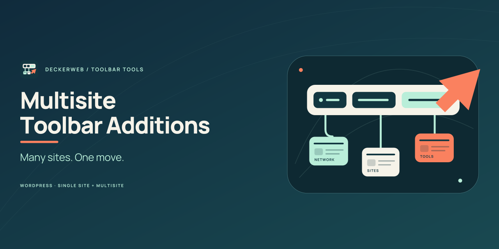
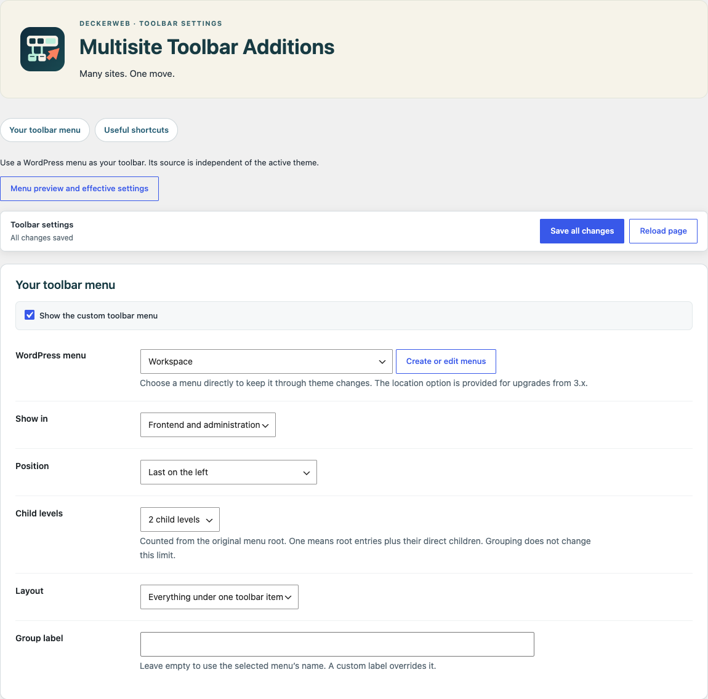
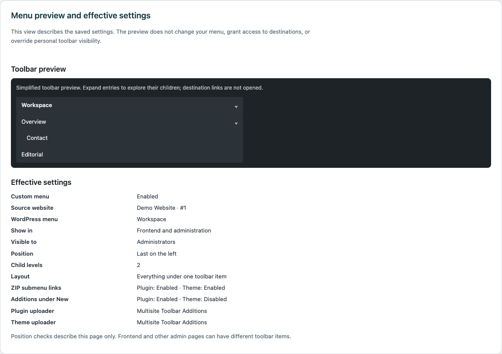

# Multisite Toolbar Additions

## About

**Many sites. One move.**

**For single WordPress sites and Multisite networks. Both have been supported since 2012.**

Put your WordPress menu in the toolbar, alongside practical administration shortcuts. Part of the QuickNav family.

I created Multisite Toolbar Additions in 2012 for my own needs. Since then, it has been part of every personal and client WordPress installation I manage, and it remains one of my favorite everyday helper plugins.

**Version 4.1.0 · WordPress 6.7+ · PHP 8.2+**

[English](README.md) · [Deutsch](README-de.md) · [Download](https://github.com/deckerweb/multisite-toolbar-additions/releases/latest) · [FAQ by topic](https://github.com/deckerweb/multisite-toolbar-additions/wiki/FAQ-English)

## Contents

[At a glance](#at-a-glance) · [Installation and first steps](#installation-and-first-steps) · [Main features](#main-features) · [FAQ](#faq) · [Screenshots](#screenshots) · [Changelog](#changelog) · [Project](#project) · [Support and security](#support-and-security) · [License and credits](#license-and-credits)

## At a glance

- Select a source site and menu independently of your theme. Keep root entries separate or group them under the menu’s name. A custom label is optional.
- Choose first/last, before/after a reference item or the right side. Show the menu on the frontend, in administration or both. Choose one to ten child levels, or all. Missing references fall back to the end.
- Plugins and Themes appear consecutively in the website toolbar menu, including Multisite. Additions under New remain last and have independent switches: Plugins on, Themes off. Both ZIP admin submenu links default to on. Upload links use active Leitstand pages or dedicated local pages with drag-and-drop and bounded metadata previews; WordPress performs installation.
- Use one network-wide menu source with optional viewing by website administrators. Shared menus remain editable only by super administrators. Destination permissions still apply; website expansion is bounded.
- Library 0.6.0 offers curated plugins with prerequisite/hash checks and optional online catalog updates. Updater 2.1.0 uses normal WordPress updates. Assets are local; no telemetry is collected.
- Inspect the menu structure with the selected depth and grouping without saving. A compact overview explains visibility, positioning and active uploader providers. Missing sources and page-specific missing toolbar anchors are explained.

## Installation and first steps

Requires WordPress 6.7+ and PHP 8.2+. Install the released ZIP via Plugins → Add New → Upload Plugin. Open Settings → Toolbar Additions. For Multisite network activation, use Network Admin → Settings → Toolbar Additions. Site-only activation uses the active site’s settings page and still requires a super administrator for network settings. The optional catalog installer needs PHP ZipArchive. Review custom 3.x snippets before a major upgrade.

## Main features

### Your WordPress menu

Select a source site and menu independently of your theme. Keep root entries separate or group them under the menu’s name. A custom label is optional.

### Position, visibility and depth

Choose first/last, before/after a reference item or the right side. Show the menu on the frontend, in administration or both. Choose one to ten child levels, or all. Missing references fall back to the end.

### Upload shortcuts

Plugins and Themes appear consecutively in the website toolbar menu, including Multisite. Additions under New remain last and have independent switches: Plugins on, Themes off. Both ZIP admin submenu links default to on. Upload links use active Leitstand pages or dedicated local pages with drag-and-drop and bounded metadata previews; WordPress performs installation.

### Multisite administration

Use one network-wide menu source with optional viewing by website administrators. Shared menus remain editable only by super administrators. Destination permissions still apply; website expansion is bounded.

### Shared components

Library 0.6.0 offers curated plugins with prerequisite/hash checks and optional online catalog updates. Updater 2.1.0 uses normal WordPress updates. Assets are local; no telemetry is collected.

### Menu preview and diagnostics

Inspect the menu structure with the selected depth and grouping without saving. A compact overview explains visibility, positioning and active uploader providers. Missing sources and page-specific missing toolbar anchors are explained.

## FAQ

### Is Multisite required?

No. Single WordPress sites and Multisite networks have both been supported since the first release in 2012. On a single site, you can use the configurable toolbar menu, plugin/theme ZIP uploaders, menu preview and settings. Multisite adds network administration and shared-menu features.

### How do I select my toolbar menu?

Create a normal navigation menu and select its source site and menu in the settings. Network activation defaults to the main website; site-only activation defaults to the active website. Activate the plugin on the source website or across the network so that shared-menu protection can run. The legacy mstba_menu location remains a fallback.

### Can I change position and visibility?

Yes: first, last, before or after a selected toolbar item, or on the right. Choose frontend, admin or both, and the permitted audience. If an anchor is missing, the menu falls back to the end.

### Can ordinary site admins edit a shared menu?

The toolbar audience and permission to edit its source menu are separate. Shared Multisite source menus are protected against unauthorized admin, REST and Customizer changes.

### Which upload shortcuts are enabled by default?

Both Plugin ZIP and Theme ZIP admin submenu links are enabled. The previous hidden Theme submenu default transitions once; the next save records the transition and later explicit disabled choices remain effective. Under New, Plugins remain enabled and Themes disabled. Each addition has its own switch. Themes follows Plugins directly in the website toolbar menu, including Multisite.

### How do plugin updates work?

The bundled deckerweb Updater 2.1.0 checks this fixed public repository and caches release metadata. WordPress controls individual, bulk and automatic updates. The plugin does not enable automatic updates. Packages must match the offered version, plugin identity and platform requirements before replacing the installed copy.

### What happens when I deactivate or uninstall?

Deactivation keeps all settings and WordPress menus. Uninstall clears this plugin’s update cache. Toolbar settings are retained unless the deletion option is enabled for that site or network. On physical removal every network’s own choice is respected. Shared Library cleanup runs only after its last installed host is removed, including inactive hosts; its own deletion option is separate. Installed plugins, navigation menus and foreign content remain untouched.

[FAQ by topic](https://github.com/deckerweb/multisite-toolbar-additions/wiki/FAQ-English)

## Screenshots

Settings on a single WordPress site: toolbar menu, visibility, position and depth.

Toolbar-style menu preview and effective settings on a single WordPress site.

## Changelog

### 4.1.0 · 2026-10-07

- **New:** Dedicated plugin and theme ZIP upload pages include drag-and-drop, package previews and explicit installation confirmation. Active Leitstand uploaders are reused without duplicate pages.
- **New:** Preview menu structure, grouping and child levels without saving; see effective settings, active uploaders and explanations for missing menu sources or toolbar reference items.
- **Improved:** A sticky save bar keeps saving accessible and warns before discarding unsaved changes. The group-label field is larger.
- **Improved:** Both ZIP admin submenu links are enabled by default; the previous hidden Theme submenu default transitions once. Later explicit choices remain respected. The separate Theme addition under New remains off by default.
- **Improved:** Plugins and Themes appear consecutively in the website toolbar menu, including Multisite. Site-only activation is supported with super-administrator-managed network settings.
- **Improved:** Update shared components to Library 0.6.0 and Updater 2.1.0, with informal/formal German host translations and readable local release history.
- **Fixed:** Recognize plugin/theme ZIP type mismatches and link to the correct uploader. New theme packages preview correctly before their first installation.
- **Fixed:** Validate candidate identity, version and requirements in bulk updates; require authenticated POST requests when saving settings.
- **Fixed:** Keep toolbar features available when an embedded component is incomplete; safely ignore malformed integration entries and preserve last-position ordering after late toolbar additions.
- **Fixed:** Refresh local CSS and JavaScript when package contents change, including same-version replacements.
- **Misc:** Deactivation preserves data. Uninstall clears own update caches; deleting toolbar settings remains optional and off by default. WordPress menus and other plugin data are retained.
- **Misc:** Clarify support for single WordPress sites and Multisite networks throughout the documentation.

### 4.0.0 · 2026-10-01

- **New:** Configure the source menu, audience, frontend/admin visibility, position, grouping and child levels.
- **New:** Plugin and Theme shortcuts have separate switches; Plugins are enabled and Themes disabled by default.
- **New:** Upload theme ZIPs through a dedicated page using the WordPress installer, including network installation.
- **New:** The bundled deckerweb Library 0.2.0 offers approved plugins with package and dependency checks.
- **Improved:** Menu data is reused per request; additional website shortcuts are limited for large networks.
- **Improved:** Plugin and Theme entries appear last under New; an empty group label follows the WordPress menu name.
- **Improved:** Local documentation, update artwork and a shared footer are available in English and German.
- **Fixed:** Shared menus are protected from unauthorized classic, REST and Customizer changes; menu output and settings are validated.
- **Fixed:** Cached WordPress update offers retain the plugin’s own icons.
- **Misc:** Requires WordPress 6.7 and PHP 8.2. German informal and formal language resources are included.

### 3.1.0 · 2025-04-03

- **New:** The toolbar remains available in the fullscreen block editor.
- **New:** Git Updater and DevKit Pro shortcuts are supported; Git Updater can install and update this plugin.
- **Improved:** German language resources include native PHP translation catalogs.

### 3.0.0 · 2025-03

- **Improved:** Administration shortcuts use a smaller set of current integrations.
- **Misc:** The restricted website-administrator menu, obsolete integrations and the former recommendations library were removed; the shared super-administrator menu remains.
- **Misc:** Distribution moved from WordPress.org to direct ZIP installation and GitHub.

### 2.0.1 · 2019-09-23

- **Improved:** The recommendations library 1.5.0 caches data to reduce repeated requests.

### 2.0.0 · 2019-05-04

- **New:** Dedicated plugin/theme ZIP upload pages and installer shortcuts are available.
- **New:** Site Health includes plugin diagnostics on WordPress 5.2 or newer.
- **New:** A DECKERWEB plugin newsletter is available.
- **Improved:** Recommendations library 1.4.0 and German Du/Sie translations were updated.

### 1.9.4 · 2018-11-03

- **Improved:** Recommendations library 1.2.0 improves installer styles and Dark Mode compatibility.

[Full history](docs/CHANGELOG.md)

## Project

David Decker has developed and maintained this plugin since 2012. The QuickNav family shortens everyday WordPress administration. Its established name is retained.

## Support and security

[Issues](https://github.com/deckerweb/multisite-toolbar-additions/issues) · [Discussions](https://github.com/deckerweb/multisite-toolbar-additions/discussions) · [Security reporting](SECURITY.md)

[Ko-fi](https://ko-fi.com/deckerweb) · [Buy Me a Coffee](https://buymeacoffee.com/daveshine) · [PayPal](https://paypal.me/deckerweb)

## License and credits

© 2012–2026 David Decker – DECKERWEB. [GPL v2 or later](LICENSE).

Library and Updater: David Decker, GPL-2.0-or-later. Footer and release history are based on public deckerweb reference plugins. Launch Rail artwork: David Decker, GPL-2.0-or-later; local system fonts. Sources and component versions: [Shared components](docs/LIBRARIES.md).
